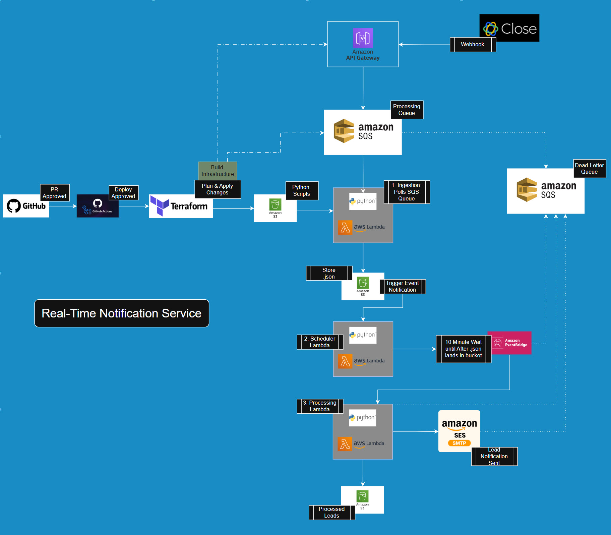

# Real Time Lead Notification Pipeine

  
Notification Pipeline that forwards received messages from Close API webhook that is ingested using an AWS API Endpoint, transferred to an SQS Queue, then saved to an S3 bucket. This bucket is linked to an event trigger that calls another Lambda function that schedules a 30 minute wait task implemented to pause for time for lead assignment, then processed after gathering that lead assignment information stored in an external, yet publicly available S3 bucket. After the last of the data is fetched an email is sent with all pertinent lead information using AWS SES.

  
## Notes About the Architecture

### API Gateway

Instead of risking that a http trigger on a Lambda Function hitting concurrency limits and potentially rejecting requests, using AWS API Gateway allows for acceptance of ten thousand messages per second (and higher if needed), better security by having built in throttling and rate limiting, and can require API keys protecting downstream queue and Lambda resources.

Lambda Function URL triggers only support public access or AWS IAM authentication while the API Gateway supports many more methods of modern access control such as AWS Cognito, or JWT authorizers.

  
### Amazon SQS
By implementing a SQS Queue to sit between the Lambda Function and API post request we allow for automatic polling and scaling of up to 1,000 concurrent executions. If a spike occurs Lambda automatically creates parallel workers that can handle processing 10 messages per invocation by default but up to 10,000 messages per invocation (only limited by 256KB maximum payload per batch and Lambda's 6MB synchronous/256 KB asynchronous payload limits within its 1,000 concurrent parallel workers), which can reduce costs of high-volume processing. If this will overwhelm downstream processing steps you can set the concurrency limits to only send what your downstream systems can handle, reducing the need to increase those downstream resources to handle spikes, while not losing messages throughout. Also if the Lambda function stops for any reason a DLQ can be implemented to retain records to be replayed as needed. 
  
### AWS Lambda
The code is maintained in a GitHub repository, and connected to Lambda functions through an OIDC trust relationship. At each release to production a generated commit hash is stored with every update of artifact code, linking each run to a commit in the repository. Queue Messaging and polling, as well as EventBridge triggers are used to invoke different Lambda Functions during this notification process.
  

### S3 Bucket
The processing bucket is linked to an event trigger that then invokes a different Lambda Function responsible for scheduling an AWS EventBridge wait process of 30 minutes to  account for the time it takes from lead generation to lead assignment before the final processing can occur. A file lookup in an external S3 bucket that holds the assignment occurs and the files once completed move from in-process to processed and an email is sent using AWS SES that holds all pertinent information required to complete the process
 
 
 
## CI/CD Pipeline

### GitHub Actions Workflow
The workflow was used to first run a suite of basic tests to ensure no functionality is broken during the most recent code push. If the test fails the build fails, and no changes are made to the AWS infrastructure. If successful, artifacts are zipped and stored in the correct location for each AWS lambda handler necessary to run the pipeline. No static keys are kept throughout the entire repository

 

### Terraform
Upon successful build, Terraform is completely responsible for creating, and maintaining all AWS resources, this entire environment can be created or destroyed with a command, and any changes made to the Lambda functions, the SQS Queue, the EventBridge wait scheduler or the S3 buckets are handled upon merge to the production environment linked to the master repository branch in GitHub
